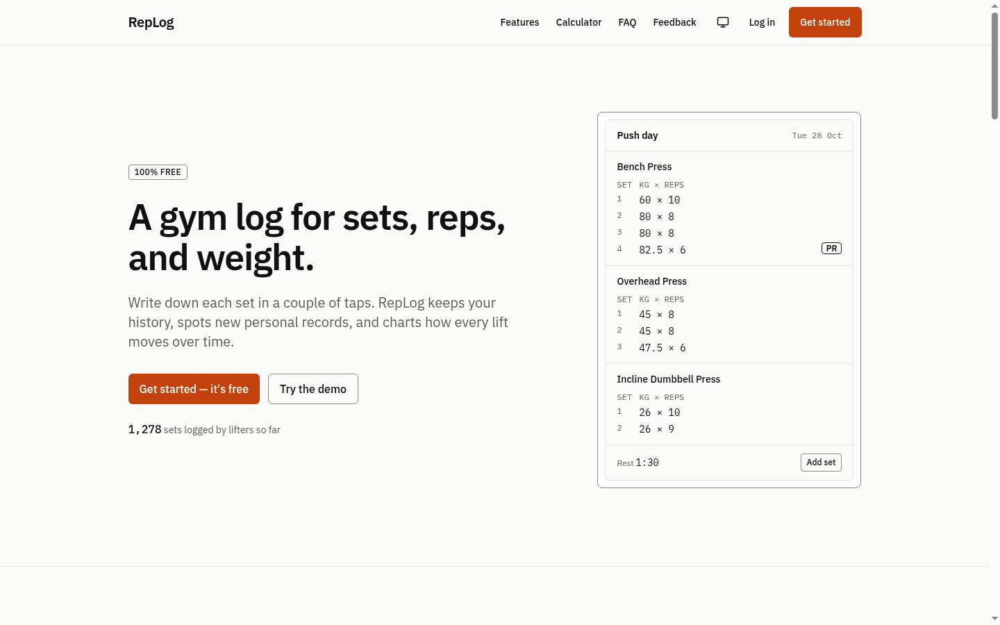
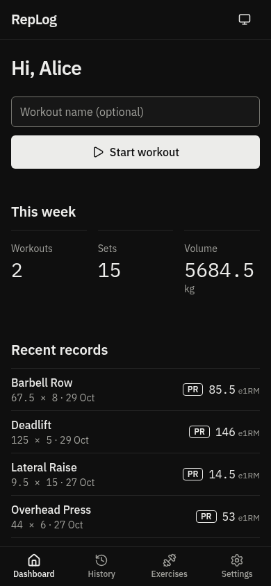
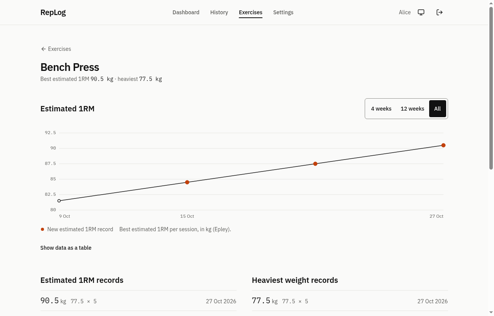

# RepLog

**RepLog** is a free gym log for sets, reps, and weight. Sign up, start a workout, log
each set in a couple of taps, and RepLog keeps your history, spots personal records, and
charts your estimated 1RM over time. A read-only demo account lets anyone look around
without signing up.

It is a portfolio project. The goal is to show careful frontend work (responsive,
accessible, one-handed on a phone) together with correct security on a "serverless"
stack: two-sided validation, rate limiting, authentication, authorization, and Row Level
Security as the last line of defence.

| Landing page                                                   | Dashboard (phone, dark)                                            | Progress chart                                                    |
| -------------------------------------------------------------- | ------------------------------------------------------------------ | ----------------------------------------------------------------- |
|  |  |  |

**Demo:** _add the Vercel URL here after deploying._

## Features

- **Workout logging** (`/app/workout/[id]`): exercise autocomplete that suggests your own
  exercises first, weight and reps pre-filled from last time, "Repeat last set",
  optimistic saving with retry, edit and delete with confirmation. On phones the add-set
  form and rest timer sit at the bottom of the screen for one-handed use.
- **Rest timer**: starts when you add a set; 60/90/120/180 s, ±15 s, vibration and a beep.
- **Personal records**: heaviest weight and estimated 1RM (Epley), computed in the
  database. The first set of an exercise and equal values are not records.
- **History** with session summaries (duration, sets, volume, new records), editable sets,
  names, and notes.
- **Progress** per exercise: a hand-drawn SVG chart (4 weeks / 12 weeks / all), a data table
  alternative, record lists, and the last 10 sets.
- **Dashboard**: continue the active workout, this week's totals (weeks start on Monday in
  your time zone), recent records, last workouts.
- **Accounts**: sign up with email confirmation, login, logout, forgot/reset password,
  change display name, delete account.
- **Landing page**: 1RM calculator, honest feature list and comparison, FAQ, feedback form,
  and a live "sets logged" counter.
- **Admin** (`/admin`): aggregate numbers only, plus the feedback inbox.

## Tech stack

| Part            | Choice                                                            |
| --------------- | ----------------------------------------------------------------- |
| Framework       | Next.js 16 (App Router, Server Actions, `proxy.ts`), React 19     |
| Language        | TypeScript, `strict: true`                                        |
| Styling         | Tailwind CSS v4, design tokens in `app/globals.css`               |
| Database / Auth | Supabase (PostgreSQL, Auth, RLS)                                  |
| Validation      | Zod, one set of schemas for client and server                     |
| Rate limiting   | PostgreSQL table + function, no extra service                     |
| Charts          | Hand-written SVG                                                  |
| Icons           | `lucide-react`                                                    |
| Tests           | Vitest, plus SQL assertions on a throwaway Postgres container     |
| CI              | GitHub Actions: lint, format, typecheck, test, and database tests |
| Hosting         | Vercel                                                            |

No UI or chart libraries: the combobox, dialogs, accordion, tabs, timer, and chart are
hand-written.

## Architecture

```
Browser
  │
  ├── Landing page (public, static + 60 s revalidation)
  ├── /signup, /login, /forgot-password, /reset-password, /auth/callback
  ├── /app/*    (signed in)
  ├── /admin/*  (signed in + admin role)
  │
  ├── Server Actions / Route Handlers (Vercel)
  │      1. session check (401) and demo check (403) for app writes
  │      2. rate limit (RPC to Supabase, per IP or per user)
  │      3. Zod validation (400)
  │      4. query with the USER'S SESSION (anon key + cookie) → RLS applies
  ▼
Supabase (PostgreSQL + Auth + RLS)
```

### Security decisions

- **All workout data is read and written with the user's own session**, never the service
  role, so Row Level Security always applies. Every user-owned table has `user_id`, and RLS
  limits users to their own rows. Another user's workout id simply returns nothing, and the
  page answers 404 (not 403), so it doesn't reveal that the workout exists.
- **The service role is only used for** the rate limit RPC, anonymous feedback inserts, and
  deleting an account (`auth.admin.deleteUser`). It lives in `lib/supabase/service.ts`,
  which starts with `import "server-only"`.
- **Column-level grants**: users can only write the columns they own the meaning of
  (`name`, `notes`, `exercise_name`, `weight_kg`, `reps`, `display_name`). `user_id`,
  `is_demo`, and timestamps cannot be set through the API.
- **Abuse limits in the database**: at most 100 sets per workout and 20 workouts per 24
  hours (triggers), one active workout per user (unique index), and sets must belong to the
  owner of their workout. These hold even for someone calling the REST API directly with
  their own JWT.
- **The demo account is read-only in RLS**: every insert, update, and delete policy checks
  `not is_demo()`. The UI also disables those controls and shows a banner.
- **Admins never see users' data.** `get_admin_stats()` returns counts only (demo excluded)
  and raises an error for non-admins. RLS gives admins no access to workouts or sets.
- **anon** can call one function, `get_total_sets_logged()`, which returns a number.
- **Rate limits** are a fixed window in Postgres (`check_rate_limit()`, atomic
  `INSERT … ON CONFLICT`), callable only by `service_role`. Keys are
  `{action}:{sha256(identifier + RATE_LIMIT_SALT)}`, where the identifier is the IP or, for
  signed-in actions, the user id (so people on the same gym Wi-Fi don't block each other).
  Raw IPs and ids are never stored. If the check fails, the request is refused (fail closed).

  | Action            | Limit              |
  | ----------------- | ------------------ |
  | `signup`          | 5 / 60 min / IP    |
  | `login`           | 10 / 15 min / IP   |
  | `forgot-password` | 3 / 60 min / IP    |
  | `demo-login`      | 20 / 60 min / IP   |
  | `app-write`       | 120 / 1 min / user |
  | `delete-account`  | 3 / 60 min / user  |
  | `feedback`        | 3 / 10 min / IP    |
  | `admin-login`     | 5 / 15 min / IP    |
  | `admin-read`      | 60 / 1 min / IP    |

- **Auth details**: sign-up and forgot-password show the same message whether or not the
  email is registered; login failures say "Invalid email or password." (an unconfirmed
  email gets its own hint). `/auth/callback` only redirects to internal paths
  (`lib/safe-redirect.ts`). `/reset-password` only works right after a recovery link.
- **Defence in depth for routes**: `proxy.ts` redirects signed-out visitors of `/app/*` to
  `/login?next=…`, but every page, Server Action, and Route Handler checks the session
  itself (`requireUser()`, `requireAdmin()`).
- **Validation on both sides** with the same Zod schemas; URL ids are validated as UUIDs.
- Security headers (`next.config.ts`): `X-Content-Type-Options`, `Referrer-Policy`,
  `X-Frame-Options: DENY`, `Permissions-Policy` (camera, microphone, geolocation off), HSTS.

## Running locally

Requirements: Node.js 20.9+ and a Supabase project.

```bash
npm install
cp .env.example .env.local   # then fill in the values
npm run dev                  # http://localhost:3000
```

Other scripts:

```bash
npm run lint          # ESLint
npm run format:check  # Prettier
npm run typecheck     # next typegen + tsc --noEmit
npm test              # Vitest
npm run build         # production build
bash supabase/tests/run-local.sh   # migrations + SQL assertions on a local Postgres (Docker)
```

`run-local.sh` starts a throwaway Postgres container, applies both migrations and the demo
seed, and runs the assertions in `supabase/tests/` (RLS between users, demo read-only, PR
detection, limits, admin aggregates, account deletion cascade). It never touches Supabase.

## Supabase setup

### 1. Migrations

Run these once, in order, in the Supabase SQL Editor (or with `supabase db push` after
`supabase link`):

1. `supabase/migrations/0001_init.sql`
2. `supabase/migrations/0002_app.sql` (removes the old waitlist, adds profiles, workouts,
   sets, RLS, triggers, functions, and the record/progress views)

### 2. Auth settings

- **Authentication → Sign In / Providers → Email**: sign-ups **on**, **Confirm email on**.
- **Authentication → URL Configuration**: Site URL = your deployed URL (or
  `http://localhost:3000` locally). Add `https://<your-domain>/auth/callback` and
  `http://localhost:3000/auth/callback` to the Redirect URLs.
- Optional, recommended: set up custom SMTP (Supabase's built-in email has a low hourly
  limit). To make confirmation and reset links work when opened on a different device than
  the one used to sign up, change the email templates to link to
  `{{ .SiteURL }}/auth/callback?token_hash={{ .TokenHash }}&type=signup&next=/app`
  (confirm signup) and
  `{{ .SiteURL }}/auth/callback?token_hash={{ .TokenHash }}&type=recovery&next=/reset-password`
  (reset password). The default templates work in the same browser.

### 3. Rate limit cleanup

The first migration schedules a daily `pg_cron` job (`replog-rate-limits-cleanup`) when the
extension is available. Otherwise enable **pg_cron** under Database → Extensions and re-run
the `do $do$ … $do$` block at the end of `0001_init.sql`, or run this from time to time:

```sql
delete from public.rate_limits where window_start < now() - interval '24 hours';
```

### 4. Demo account

1. **Authentication → Users → Add user**: create the demo user (e.g.
   `demo@your-domain.com`) with a strong password and **Auto Confirm User** ticked. Copy its
   UUID.
2. Open `supabase/seed/demo.sql`, replace `00000000-0000-0000-0000-000000000000` with that
   UUID, and run it in the SQL Editor. It marks the profile as demo and creates six weeks of
   workouts. Running it again refreshes the data.
3. Set `DEMO_USER_EMAIL` and `DEMO_USER_PASSWORD` in your environment.

### 5. Admin account

1. Create (or sign up) the admin user, then in the SQL Editor:

   ```sql
   insert into public.admins (user_id)
   select id from auth.users where email = 'you@example.com';
   ```

A signed-in user without a row in `public.admins` sees a 403 page at `/admin` and gets 403
from `/api/admin/*`.

## Environment variables

| Name                            | Where           | Notes                                                                          |
| ------------------------------- | --------------- | ------------------------------------------------------------------------------ |
| `NEXT_PUBLIC_SUPABASE_URL`      | client + server | Supabase project URL                                                           |
| `NEXT_PUBLIC_SUPABASE_ANON_KEY` | client + server | Anon / publishable key. Safe to expose: RLS limits everything it can do        |
| `NEXT_PUBLIC_SITE_URL`          | client + server | Site URL for links in auth emails. Locally `http://localhost:3000`             |
| `SUPABASE_SERVICE_ROLE_KEY`     | **server only** | Service role / secret key. Never prefix with `NEXT_PUBLIC_`                    |
| `RATE_LIMIT_SALT`               | **server only** | Long random string (16+ chars) for hashing IPs, e.g. `openssl rand -base64 32` |
| `DEMO_USER_EMAIL`               | **server only** | Email of the read-only demo account                                            |
| `DEMO_USER_PASSWORD`            | **server only** | Password of the demo account                                                   |

`.env.local` is git-ignored. `.env.example` lists the names without values.

## Lighthouse

Local production build, Lighthouse 12, mobile emulation (the `/app` pages were measured
with a local stand-in for Supabase serving sample data):

| Page                   | Performance | Accessibility | Best Practices | SEO           |
| ---------------------- | ----------- | ------------- | -------------- | ------------- |
| `/`                    | 99          | 100           | 100            | 100           |
| `/login`, `/signup`    | 99          | 100           | 100            | 100           |
| `/app`                 | 99          | 100           | 100            | n/a (noindex) |
| `/app/exercises/[key]` | 99          | 100           | 100            | n/a (noindex) |

Re-run against the deployed URL after deploying; numbers on Vercel will differ slightly.

## Project structure

```
app/
  (auth)/                signup, login, forgot/reset password, auth Server Actions
  auth/callback/         email link → session
  app/                   the app: dashboard, workout, history, exercises, settings, actions.ts
  admin/                 admin login and aggregate dashboard
  api/                   feedback and admin Route Handlers
components/
  app/                   SetForm, SetList, RestTimer, SessionSummary, ProgressChart, AppNav…
  auth/                  AuthForm and the auth page shell
  landing/               Navbar, Hero, Features, Comparison, Faq, StartCta, Footer…
  calculator/            OneRepMaxCalculator, ExerciseCombobox, HistoryList
  feedback/              FeedbackModal and its provider
  admin/                 feedback table
  ui/                    Button, Field, ConfirmDialog, Pagination, LocalTime, ThemeToggle…
lib/
  workout/               pure helpers (grouping, volume, summary, chart, week) + queries
  auth/                  requireUser, requireAdmin, route rules, action rate limit
  validation/schemas.ts  every Zod schema
  safe-redirect.ts, rate-limit.ts, http.ts, supabase/…
proxy.ts                 session refresh + /app and /admin redirects
supabase/migrations/     0001_init.sql, 0002_app.sql
supabase/seed/demo.sql   demo account data
supabase/tests/          local Postgres runner and SQL assertions
tests/                   Vitest
```
