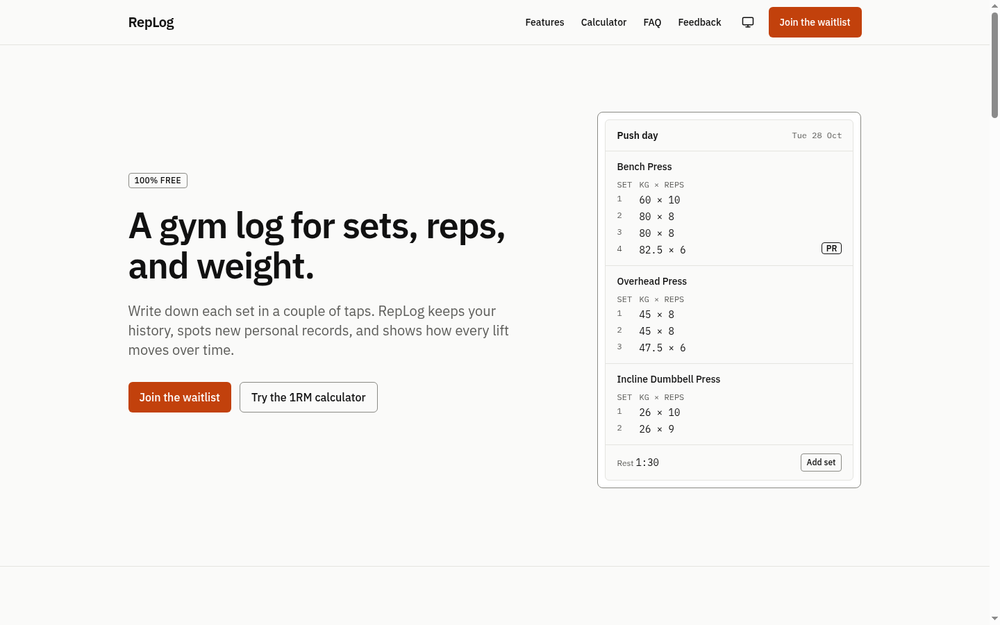
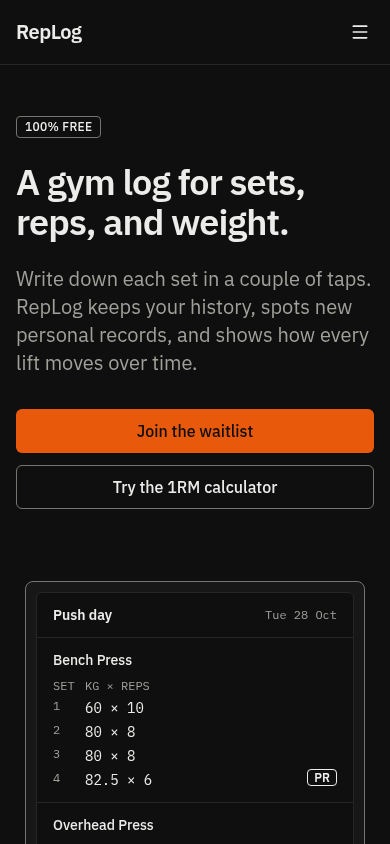

# RepLog

Landing page for **RepLog**, a fictional, free gym log for sets, reps, and weight. The app
itself is not built; this project is the landing page around it: a 1RM calculator with an
exercise autocomplete, a waitlist, a feedback form, and a small admin area.

It is a portfolio project. The goal is to show careful frontend work (responsive layout,
accessibility, non-trivial client logic) together with correct security on a "serverless"
stack: two-sided validation, rate limiting, authentication, authorization, and Row Level
Security.

| Desktop (light)                                            | Phone (dark)                                          |
| ---------------------------------------------------------- | ----------------------------------------------------- |
|  |  |

**Demo:** _add the Vercel URL here after deploying._

## Tech stack

| Part            | Choice                                              |
| --------------- | --------------------------------------------------- |
| Framework       | Next.js 16 (App Router, `proxy.ts`), React 19       |
| Language        | TypeScript, `strict: true`                          |
| Styling         | Tailwind CSS v4, design tokens in `app/globals.css` |
| Database / Auth | Supabase (PostgreSQL, Auth, RLS)                    |
| Validation      | Zod, one set of schemas for client and server       |
| Rate limiting   | PostgreSQL table + function, no extra service       |
| Icons           | `lucide-react`                                      |
| Tests           | Vitest                                              |
| CI              | GitHub Actions: lint, format check, typecheck, test |
| Hosting         | Vercel                                              |

No UI libraries: the combobox, modal, accordion, tabs, and theme switcher are hand-written.

## Architecture

```
Browser
  │
  ├── Landing page (Server Component + Client Components)
  │      └── calculator, combobox, history, dark mode, FAQ → client only
  │
  ├── POST /api/waitlist ─┐
  ├── POST /api/feedback ─┤
  │                       ├──► Route Handler / Server Action (Vercel)
  ├── /admin (login)      │       1. Content-Type and body size
  ├── GET /api/admin/* ───┘       2. rate limit (RPC to Supabase)
  │                               3. Zod validation
  │                               4. authn + authz (admin only)
  │                               5. query Supabase
  ▼
Supabase (PostgreSQL + Auth + RLS)
```

### Security decisions

- **Visitors never write to the database directly.** The anon key is public, so if the
  `anon` role could insert, anyone could skip the rate limit and validation by calling the
  Supabase REST API. `anon` therefore has no table privileges and no policies. Visitor
  inserts go through Route Handlers using the service role key, which only exists on the
  server (`lib/supabase/service.ts` starts with `import "server-only"`).
- The only thing `anon` may call is `get_waitlist_count()`, which returns a number.
- **Rate limits** are a fixed window in Postgres (`check_rate_limit()`, atomic
  `INSERT … ON CONFLICT`), callable only by `service_role`. Keys are
  `{action}:{sha256(ip + RATE_LIMIT_SALT)}`; raw IPs are never stored. If the check fails,
  requests are refused with 503 (fail closed).

  | Action        | Limit           |
  | ------------- | --------------- |
  | `waitlist`    | 5 / 60 min / IP |
  | `feedback`    | 3 / 10 min / IP |
  | `admin-login` | 5 / 15 min / IP |
  | `admin-read`  | 60 / 1 min / IP |

- **Validation on both sides.** `lib/validation/schemas.ts` is used by the forms and the
  Route Handlers; the server is the source of truth and the database has `CHECK`,
  `UNIQUE`, and `NOT NULL` constraints as the last layer. Write endpoints check, in order:
  415 Content-Type → 413 body > 10 KB → 429 rate limit → 400 JSON → 400 schema →
  honeypot (fake 201) → insert.
- **Admin access has three layers:** `proxy.ts` redirects signed-out users to
  `/admin/login`; `requireAdmin()` checks the session (401) and the `admins` table (403) on
  every admin page and API call; and RLS only lets `is_admin()` users `SELECT` waitlist and
  feedback rows. Admin data is read with the user's own session, not the service role, so
  RLS always applies.
- Login errors are always "Invalid email or password." Sign-up is disabled.
- Security headers (`next.config.ts`): `X-Content-Type-Options`, `Referrer-Policy`,
  `X-Frame-Options: DENY`, `Permissions-Policy` (camera, microphone, geolocation off), HSTS.

## Running locally

Requirements: Node.js 20.9+ and a Supabase project.

```bash
npm install
cp .env.example .env.local   # then fill in the values
npm run dev                  # http://localhost:3000
```

Other scripts:

```bash
npm run lint          # ESLint
npm run format:check  # Prettier
npm run typecheck     # next typegen + tsc --noEmit
npm test              # Vitest
npm run build         # production build
```

Without Supabase variables the landing page still works (the counter is hidden), and the
write endpoints answer 503 because the rate limit cannot be checked.

## Supabase setup

### 1. Migration

Run `supabase/migrations/0001_init.sql` once, either in the Supabase SQL Editor (paste and
run) or with the Supabase CLI (`supabase db push` after `supabase link`).

To check the migration and RLS on a throwaway local Postgres container (needs Docker and
`psql`; never touches your Supabase project):

```bash
bash supabase/tests/run-local.sh
```

### 2. Rate limit cleanup

The migration schedules a daily `pg_cron` job (`replog-rate-limits-cleanup`) when the
extension is available. If it is not, enable **pg_cron** under Database → Extensions and
re-run the `do $do$ … $do$` block at the end of the migration, or run this manually from
time to time:

```sql
delete from public.rate_limits where window_start < now() - interval '24 hours';
```

### 3. Admin account

Admin accounts are created by hand. There is no sign-up page.

1. Supabase Dashboard → **Authentication → Sign In / Providers** → turn off **Allow new
   users to sign up**.
2. **Authentication → Users → Add user**: create the admin with an email and a strong
   password. Copy the new user's UUID.
3. **SQL Editor**:

   ```sql
   insert into public.admins (user_id) values ('<uuid of the admin user>');
   ```

A signed-in user without a row in `public.admins` sees a 403 page and gets 403 from
`/api/admin/*`.

## Environment variables

| Name                            | Where           | Notes                                                                          |
| ------------------------------- | --------------- | ------------------------------------------------------------------------------ |
| `NEXT_PUBLIC_SUPABASE_URL`      | client + server | Supabase project URL                                                           |
| `NEXT_PUBLIC_SUPABASE_ANON_KEY` | client + server | Anon / publishable key. Safe to expose: `anon` has no table rights             |
| `SUPABASE_SERVICE_ROLE_KEY`     | **server only** | Service role / secret key. Never prefix with `NEXT_PUBLIC_`                    |
| `RATE_LIMIT_SALT`               | **server only** | Long random string (16+ chars) for hashing IPs, e.g. `openssl rand -base64 32` |

`.env.local` is git-ignored. `.env.example` lists the names without values.

## Lighthouse

Local production build (`next build && next start`), Lighthouse 12, mobile emulation:

| Page           | Performance | Accessibility | Best Practices | SEO           |
| -------------- | ----------- | ------------- | -------------- | ------------- |
| `/`            | 99          | 100           | 100            | 100           |
| `/admin/login` | 99          | 100           | 100            | n/a (noindex) |

Re-run against the deployed URL after deploying; numbers on Vercel will differ slightly.

## Project structure

```
app/                     pages, Route Handlers, Server Actions, proxy-protected /admin
components/landing/      Navbar, Hero, Features, HowItWorks, Comparison, Faq, Waitlist…
components/calculator/   OneRepMaxCalculator, ExerciseCombobox, HistoryList
components/feedback/     FeedbackModal and its provider
components/admin/        tabs, tables, pagination, login form
components/ui/           Button, Field, Section, ThemeToggle
lib/                     pure logic (1RM, search, history), validation, rate limit, Supabase
proxy.ts                 session refresh + /admin redirect
supabase/migrations/     0001_init.sql
supabase/tests/          local migration + RLS check
tests/                   Vitest
```
